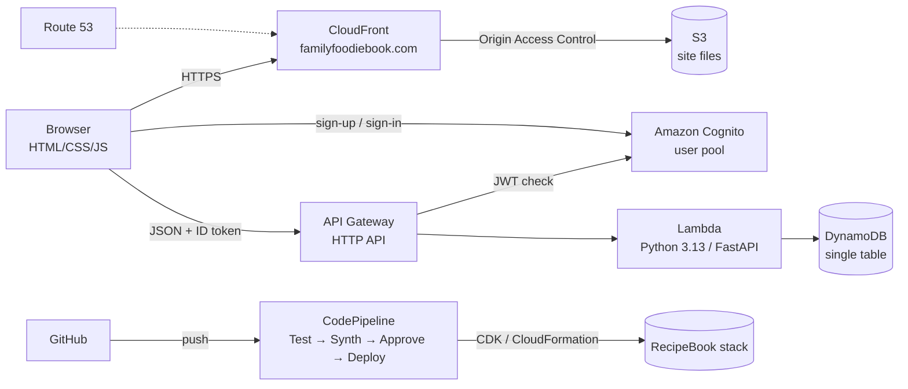

# Family Foodie Book

A family recipe website: people create accounts, write recipes, comment on each other's recipes, and join one or more **families** whose members can share recipes only they can see. It runs on AWS at **https://familyfoodiebook.com**.

This is the starting point. The details are in [`docs/`](docs/):

| Document | What's in it |
|---|---|
| [docs/architecture.md](docs/architecture.md) | How the system fits together: services, request flow, data model, security, rate limiting, CI/CD, costs, and the reasons behind each major decision |
| [docs/files.md](docs/files.md) | Every file in the repository: what it does and why it's built the way it is |
| [docs/operations.md](docs/operations.md) | Running locally, testing, deploying through the pipeline, the custom domain, troubleshooting, cleanup |
| [docs/plans/recipe-photos.md](docs/plans/recipe-photos.md) | Plan: adding photos to recipes |
| [docs/plans/world-meal-of-the-week.md](docs/plans/world-meal-of-the-week.md) | Plan: a weekly meal plan from a randomly chosen country |
| [docs/plans/email-with-ses.md](docs/plans/email-with-ses.md) | Plan: sending the site's email through Amazon SES |
| [docs/plans/monetization.md](docs/plans/monetization.md) | Plan: making money, plus the AWS and payment services it needs |
| [CHANGELOG.md](CHANGELOG.md) | What changed, and when |

## What it does

- **Accounts**: sign up with email and password, confirm with an emailed code, sign in, reset a forgotten password. The site has its own sign-in pages; Amazon Cognito does the actual account work.
- **Recipes**: title, description, ingredients and steps. Each recipe is **public** (anyone, even signed out) or **family only** (one or more of your families, which you tick).
- **My recipes**: everything you've written in one place, with your family-only recipes first. Family-only cards have their own color everywhere.
- **Sharing**: on your own recipe, **Share to Public** or **Share to Family** (pick families from styled checkboxes). Members of one family never see the names of your other families.
- **Comments** from other accounts, with current display names, "You" and "Recipe author" badges, and deletion by the comment's author or the recipe's author.
- **Families**: an account can be in up to 10. Start one, invite people with a code or a link (`/#/join/<code>`), rename it (owner), remove members (owner), or leave. Home merges the family recipes from all your families.
- **Appearance**: four seasonal themes (fall, winter, spring, summer) or "auto" by date and hemisphere, light/dark/system mode, custom accent colors with automatic contrast fixing, fonts, text size. These settings are saved to the account.
- **Rate limiting**: an overall limit at API Gateway, plus per-account and per-IP limits in the API.
- **Privacy Policy and Terms of Service** at `/privacy.html` and `/terms.html`, linked in every page's footer. Sign-up requires agreeing to both.

## Architecture in one picture



Everything that runs is defined in code with the AWS CDK (Python). The only exceptions are three things made once by hand: the domain registration (at an outside registrar), the TLS certificate in us-east-1, and the GitHub connection approval.

## Tech stack, briefly

| Layer | Choice |
|---|---|
| Frontend | Plain HTML, CSS and JavaScript. No framework and no build step. |
| Backend | Python 3.13, FastAPI, pydantic, Mangum (FastAPI inside Lambda) |
| Data | Amazon DynamoDB (one table, on-demand) |
| Accounts | Amazon Cognito user pool (Lite plan) |
| Hosting | S3 + CloudFront, Route 53 DNS, ACM certificate |
| Infrastructure | AWS CDK (Python), deployed with CloudFormation |
| CI/CD | GitHub → CodePipeline V2 + CodeBuild, with a manual approval |
| Local dev | One Python process: FastAPI + moto (fake DynamoDB) + a SQLite stand-in for Cognito |
| Tests | pytest: API behavior, gateway routes, local dev server, infrastructure, frontend checks |

AWS project: account `202518310652`, Region **us-east-2** (Ohio), CLI profile `recipe-book`. The project is on the AWS Free plan.

## Quick start

Run the whole app on your computer. No AWS access is needed, and nothing is sent to AWS:

```
infra\.venv\Scripts\python.exe backend\local_dev.py
```

Then open http://127.0.0.1:8001. The first run creates test accounts, printed in the terminal, and sample recipes. Run the tests:

```
infra\.venv\Scripts\python.exe -m pytest backend/tests infra/tests -q
```

To deploy, push to `main`. The pipeline tests and builds the change, then waits for your approval before deploying. See [docs/operations.md](docs/operations.md) for setup from scratch, approvals and troubleshooting.

## Repository map

```
frontend/         the website (static files served by CloudFront)
backend/
  recipe_api/     the API that runs in Lambda (main.py, ratelimit.py)
  local_dev.py    runs everything locally
  local_cognito.py  local stand-in for Cognito (SQLite)
  devtools.py     shared helpers for tests and local dev
  tests/          backend, frontend and local-dev tests
infra/            AWS CDK app: recipe_stack.py (the app), pipeline_stack.py (CI/CD)
  tests/          infrastructure tests
pipeline/         CodeBuild buildspecs for the Test, Synth and Deploy stages
docs/             this documentation
```
