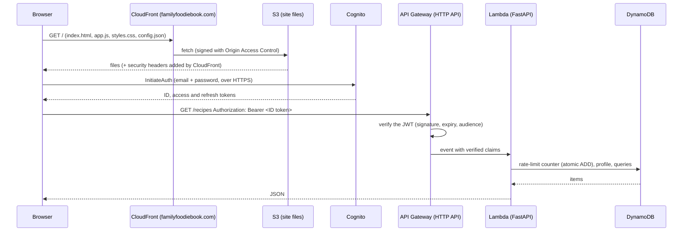
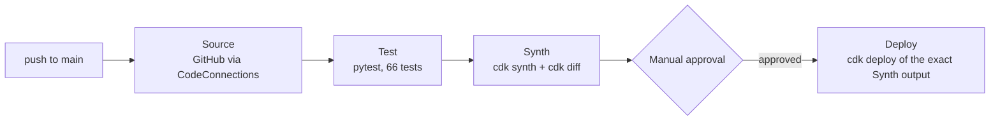

# Architecture

How Family Foodie Book is built, and why it's built that way. For individual files, see [files.md](files.md). For running and deploying, see [operations.md](operations.md).

## 1. Goals and constraints that shaped everything

The original brief: a web app on AWS with a **Python backend**, **account creation**, **recipes**, **comments from other accounts**, **families** linking accounts, and a **rate limiter**. Later additions included seasonal themes, separate public and family recipes, multiple families, invite links, and publishing.

Constraints that ruled options in or out:

| Constraint | Effect on the design |
|---|---|
| The AWS project is on the **Free plan** of the new AWS experience, with one selected Region (**us-east-2**) | Every Regional resource is in us-east-2. Only "global" pieces touch us-east-1: CloudFront and its certificate. |
| The project's service control policies **deny CloudFormation in us-east-1** | The CloudFront certificate (which must live in us-east-1) was requested once with the CLI instead of by the CDK stack. |
| **Lambda@Edge is not allowed** | The www → apex redirect is a CloudFront Function, a lighter edge feature that is allowed. |
| The SCP **denies creating IAM identity providers** (`iam:*Provider*`) | GitHub Actions with OIDC wasn't possible, so CI/CD uses CodePipeline + CodeBuild, which are in the plan. |
| **Route 53 Domains** refuses Free-plan accounts | The domain was registered at an outside registrar. Route 53 only hosts its DNS. |
| Cost should be near zero when idle | Everything is serverless and pay-per-request: Lambda, HTTP API, DynamoDB on-demand, S3 + CloudFront. There are no servers or databases billing by the hour. |
| The owner asked for detailed explanations and a review before every deploy | There's a manual approval stage in the pipeline, and a diff is reviewed before each approval. |

## 2. The services and how a request flows

1. **Static site.** CloudFront serves the files from a private S3 bucket. The bucket blocks all public access; CloudFront reads it using *Origin Access Control* (OAC), a signed identity that only this distribution has. CloudFront adds security headers and redirects HTTP to HTTPS. A CloudFront Function redirects `www.familyfoodiebook.com` and the default `*.cloudfront.net` name to the canonical `familyfoodiebook.com`.
2. **`config.json`.** This file is generated at deploy time and holds the API address, the Cognito endpoint and the app client ID. The frontend never hard-codes environment details, so the same files work for any deployment. None of these values are secrets.
3. **Sign-in.** The site's own pages call Cognito's user-pool API directly from the browser. The password goes only to Cognito, over HTTPS; the API never sees it.
4. **API calls.** The browser sends the Cognito **ID token** as a Bearer token. API Gateway's built-in Cognito JWT authorizer rejects anything invalid **before** the Lambda runs, which costs nothing per rejected request. The Lambda reads the already-verified claims (`sub`, `email`, `name`) from the event.
5. **Business logic.** FastAPI routes run inside Lambda (via Mangum) and read and write one DynamoDB table.

### Why these services

| Need | Chosen | Alternatives considered | Why |
|---|---|---|---|
| Accounts | **Cognito user pool** (Lite plan) | Write our own auth; Auth0 or another third party | Password storage, email verification, reset codes, token signing and lockout are security-critical and easy to get wrong. Cognito does them and is in the Free plan. The Lite plan covers everything used here. |
| API front door | **API Gateway HTTP API** | REST API; Lambda function URL | HTTP API is cheaper and faster than REST API and has a native JWT/Cognito authorizer. A function URL has no authorizer and no throttling. Trade-off: AWS WAF can't attach to an HTTP API directly. See the plans for putting the API behind CloudFront if WAF is ever needed. |
| Compute | **Lambda** (Python 3.13, ARM64) | Containers (ECS/Fargate), EC2 | Lambda bills per request, so idle costs nothing, and there are no servers to patch. ARM64 (Graviton) is about 20% cheaper per GB-second than x86 for the same work. |
| Framework | **FastAPI + pydantic** | Plain Lambda handlers; Flask | The owner chose FastAPI. It gives typed request and response models (pydantic), automatic validation and error shapes, an OpenAPI page for local testing (`/docs`), and the same code runs locally under uvicorn. Mangum adapts API Gateway events to ASGI. |
| Database | **DynamoDB**, one table, on-demand | Aurora Serverless / RDS (SQL); DocumentDB | The access patterns are simple and known in advance (lists by family, by public feed, by recipe). DynamoDB has no idle cost, scales automatically, and supports conditional writes and transactions, which family membership needs. A relational database would bill by the hour and needs network setup. |
| Site hosting | **S3 + CloudFront** | Amplify Hosting; an EC2 web server | It's static files, so a CDN with a private bucket is the cheapest and most secure option, with HTTPS, security headers, and edge caching worldwide. |
| DNS + TLS | **Route 53** hosted zone + **ACM** certificate | DNS at the registrar | Alias records point the apex domain at CloudFront (a plain CNAME can't do that at the apex). ACM certificates are free and renew automatically while the validation records stay in the zone. |
| Infrastructure as code | **AWS CDK (Python)** | SAM; Terraform; console clicks | The same language as the backend. Tests can check the synthesized templates. One stack holds the whole app, and changes show up as a reviewable `cdk diff`. |
| CI/CD | **CodePipeline V2 + CodeBuild** | GitHub Actions | GitHub Actions would need an IAM OIDC identity provider, which this project's policies deny. CodePipeline also keeps deploy credentials inside AWS: no long-lived keys in GitHub. |

## 3. Data model (one DynamoDB table)

All data lives in one table with a generic primary key (`pk`, `sk`) and one global secondary index (`gsi1pk`, `gsi1sk`). This is "single-table design": each kind of item gets a key prefix, and related items share a partition, so a single query fetches them together.

| pk | sk | Item | Key attributes |
|---|---|---|---|
| `USER#` | `PROFILE` | Account profile | `userId`, `email`, `displayName`, `familyIds` (a string set, up to 10), `preferences`, `createdAt` |
| `RECIPE#<id>` | `META` | Recipe | `title`, `description`, `ingredients`, `steps`, `visibility`, `familyId` (family recipes only), `authorId`, `authorName`, `createdAt`, `updatedAt`, `gsi1pk`, `gsi1sk` |
| `RECIPE#<id>` | `COMMENT#<commentId>` | Comment | `text`, `authorId`, `authorName`, `createdAt` |
| `FAMILY#<id>` | `META` | Family | `name`, `ownerId`, `inviteCode`, `createdAt` |
| `FAMILY#<id>` | `MEMBER#` | Membership | `userId`, `displayName`, `joinedAt` |
| `INVITE#<code>` | `META` | Invite code → family | `familyId` |
| `RATE#<bucket>#<identity>` | `W#<window start>` | Rate-limit counter | `count`, `expiresAt` (TTL) |

**The index (`gsi1`)** holds the recipe feeds: `gsi1pk = PUBLIC` for public recipes, or `FAMILYFEED#<familyId>` for one family's recipes. `gsi1sk = <createdAt>#<recipeId>` sorts them newest first.

**Access patterns**, each answered by a single key lookup or query:

| Need | How |
|---|---|
| Public feed | Query `gsi1` where `gsi1pk = PUBLIC`, newest first, limit 50 |
| Home feed for a member of N families | N queries (one per `FAMILYFEED#…`), merged and sorted in the Lambda, plus the public query |
| One family's recipes | Query `gsi1` for `FAMILYFEED#<id>` (members only) |
| A recipe and its comments | Get `RECIPE#<id>/META`; query `RECIPE#<id>` with `sk` beginning `COMMENT#` |
| A family and its members | Get `FAMILY#<id>/META`; query `FAMILY#<id>` with `sk` beginning `MEMBER#` |
| Join by code | Get `INVITE#<CODE>` → family ID |
| Current author names | BatchGetItem on the authors' `PROFILE` items (up to 100 per call) |

Design notes:

- **Comment IDs** start with a millisecond timestamp, so comments sort in the order they were written without a second index.
- **Author names are stored and also looked up.** Each recipe and comment stores the name used when it was written (a fallback, for example if an account is gone). Responses replace it with the author's *current* name from one batched read, so renaming yourself updates the name everywhere at once.
- **Family changes use transactions.** Creating a family writes the family, the first member, the invite code and the profile's `familyIds` in one `TransactWriteItems`. If any condition fails, for example because you're already at 10 families, nothing is written. This is what stops two simultaneous requests from getting past the rules.
- **Old data is upgraded on read.** Profiles from before multi-family support held a single `familyId`. They're converted with one conditional `ADD familyIds / REMOVE familyId` update the first time each one is read, so no migration script was needed.
- **Rate-limit counters expire automatically** through DynamoDB TTL, at no cost.
- **Retention.** The table and the Cognito user pool use `RemovalPolicy.RETAIN`: deleting the stack, or a change that would replace them, leaves the real data in place. Everything else is rebuildable and is deleted with the stack.

## 4. Security model

**Who can do what** (enforced in `backend/recipe_api/main.py`):

| Action | Allowed for |
|---|---|
| Read public recipes and their comments | Anyone, including signed-out visitors (per-IP rate limit) |
| Read a family recipe | Its author, and members of the family it belongs to. Anyone else gets **404, not 403**, so family recipes can't be discovered by guessing IDs. |
| Create a recipe | Any signed-in account. A family recipe must name a family you're in (optional when you're in exactly one). |
| Edit, delete, or publish a recipe | Its author |
| Comment | Anyone who can see the recipe |
| Delete a comment | The comment's author, or the recipe's author |
| Rename a family, make a new invite code, remove a member | The family owner |
| Leave a family | Any member. Ownership passes to the longest-standing member, and the last one out deletes the family. |
| See a family's invite code | The owner only (the API returns `null` to everyone else) |

**Layers of protection:**

- **Authentication** is done by Cognito and checked by API Gateway before any code runs. The API also refuses requests without claims, in case a route were ever misconfigured, and a test checks that only `/public/*` routes skip sign-in.
- **Passwords** are handled entirely by Cognito, which stores them in a one-way protected form. The policy is at least 10 characters with lowercase, uppercase and a digit. Cognito's `prevent_user_existence_errors` keeps sign-in errors from revealing whether an email has an account. Tokens: ID and access tokens last 1 hour, refresh tokens 30 days. Signing out revokes the refresh token.
- **Token storage.** Tokens go in `sessionStorage` (cleared when the tab closes) unless "Keep me signed in" is ticked, which uses `localStorage`. These are readable by JavaScript, so the site depends on blocking XSS, below.
- **XSS defense.** All user text is inserted with `textContent` (the `h()` helper), never as HTML. The Content Security Policy allows scripts and styles only from the site itself, with no inline scripts or styles. That's also why the copy fallback uses a CSS class rather than inline styles.
- **Security headers** (CloudFront response headers policy): CSP; `X-Content-Type-Options: nosniff`; `X-Frame-Options: DENY` plus `frame-ancestors 'none'` against clickjacking; `Referrer-Policy: strict-origin-when-cross-origin`; HSTS for one year, including subdomains.
- **CORS** allows only `https://familyfoodiebook.com`.
- **Input validation**: every request body is a pydantic model with length limits. Appearance preferences reject unknown fields, and colors must be `#rrggbb`, which stops CSS injection through saved colors.
- **Least privilege**:
  - The Lambda can only read and write its own table.
  - The S3 bucket is private and requires TLS.
  - In the pipeline, the Synth stage can only assume CDK's read-only *lookup* role. Only the Deploy stage, after approval, can assume the deploy roles.
- **Privacy**: "follow device location" stores only `north` or `south`, never coordinates. The API refuses any latitude or longitude field.

## 5. Rate limiting (two layers)

| Layer | Where | Limit | Protects against |
|---|---|---|---|
| Overall throttle | API Gateway stage | 50 requests/second steady, 100 burst, shared by everyone | Runaway cost and floods. Requests over the limit are rejected before reaching Lambda. |
| Per account | Lambda (`ratelimit.py`) | Reads 120/min, writes 30/min, comments 10/min | One account spamming comments or writes |
| Per IP (signed out) | Lambda | 60/min for public reads | Scraping the public feed |

How the per-account limits work: each request does one atomic DynamoDB `UpdateItem … ADD count 1` on the counter item for the current one-minute window. Atomic means simultaneous Lambda invocations can't double-count or miss a request. Over the limit, the API returns **429** with a `Retry-After` header plus `X-RateLimit-Limit` and `X-RateLimit-Remaining`. CORS exposes these headers so the site can show "please wait N seconds".

The trade-off: a fixed window lets someone send up to 2× the limit across a window boundary, and every request costs one small DynamoDB write. Both are fine at this scale. A sliding window or token bucket would be more precise for more reads and writes.

## 6. Frontend architecture

Plain HTML, CSS and JavaScript, as the owner asked: no framework, no bundler, no build step. The files CloudFront serves are exactly the files in `frontend/`.

- **Routing** uses the URL hash (`#/`, `#/recipe/<id>`, `#/family/<id>`, `#/join/<code>` …). Hash routes never reach the server, so S3 and CloudFront don't need rewrite rules, and any link can be bookmarked or shared.
- **One file of views** (`app.js`): each page is a function that loads data with `api()` and calls `render()`. Pages are built with a tiny `h(tag, attributes, children)` helper that sets text safely.
- **Stale-page protection.** Each navigation bumps a counter (`routeSeq`). A data load that finishes after you've already moved to another page is dropped, so a slow page can't draw over a newer one.
- **Theming** (`theme.js`) runs in `<head>` before the page draws, so there's no flash of the wrong theme. Palettes are CSS variables keyed on `data-season` and `data-mode` attributes on `<html>`. Custom accent colors are nudged until they meet WCAG's 3:1 contrast minimum.
- **Confirmations** use the site's own `<dialog>` (`confirmDialog`), not the browser's `confirm()`.
- **Accessibility**: semantic headings and landmarks, focus-visible outlines, a disclosure-pattern account menu (Escape closes it), live regions for status messages, reduced-motion support, and keyboard-reachable cards (a "stretched link" keeps one link per card).

## 7. CI/CD

- **Pipeline V2, QUEUED mode**: runs happen one at a time, in push order.
- **Deploy uses the Synth stage's cloud assembly**, so what's deployed is exactly what was diffed and approved. Nothing is rebuilt between approval and deploy.
- **Permission split**: Synth may assume only the read-only lookup role (enough for `cdk diff`). Deploy may assume the deploy, file-publishing and lookup roles. No stage has broad permissions of its own.
- **ARM build image** (`amazonlinux-aarch64-standard:4.0`), matching the Lambda's architecture, so the Python wheels bundled in Synth are the right ones.
- **The pipeline doesn't update itself.** Changes to `infra/pipeline_stack.py` need a manual `cdk deploy RecipeBookPipeline`.

## 8. Custom domain

- **Domain**: `familyfoodiebook.com`, registered outside AWS, with DNS in a Route 53 hosted zone (nameservers set at the registrar).
- **Certificate**: one ACM certificate in **us-east-1** (CloudFront only accepts certificates from there) for the apex domain and `www`, validated by DNS. The two `_…acm-validations.aws` CNAME records in the zone must stay; they're what let ACM renew the certificate automatically.
- **CloudFront** answers for both names. A **CloudFront Function** returns a 301 redirect for anything that isn't exactly `familyfoodiebook.com`, keeping the path and query string. That covers `www.` and the default `*.cloudfront.net` name.
- **Route 53** A and AAAA alias records point both names at the distribution.
- **Configuration** is in `infra/cdk.json` (`context.domain`). Without it, the stack still deploys and uses the CloudFront address.
- **Mail**: `support@familyfoodiebook.com` is received by **SES in us-east-2** (MX record), stored in a private S3 bucket and forwarded by a small Lambda to the owner's inbox, whose address is kept in Parameter Store. Any other address at the domain is rejected. The domain identity (DKIM, `mail.` MAIL FROM), SPF and DMARC (`p=none`) it needs are also the groundwork for sending the site's own email through SES later. Details: [operations.md §7](operations.md#7-support-email-supportfamilyfoodiebookcom).

## 9. Costs

Approximate, at today's small scale. Check the AWS pricing pages for exact figures:

| Item | Cost driver | Rough idle/low-traffic cost |
|---|---|---|
| Route 53 hosted zone | $0.50 per zone per month, plus queries | ≈ $0.50/month |
| DynamoDB | Per request (on-demand) and per GB stored | Cents |
| Lambda | Per request and per GB-second (ARM) | Within the free allowance |
| API Gateway HTTP API | Per million requests | Cents |
| CloudFront | Data transfer and requests | Within the always-free allowance |
| Cognito (Lite) | Monthly active users | Free at this scale |
| CodePipeline / CodeBuild | Per active pipeline, per build minute | Small; only when you push |
| ACM certificate | Free | $0 |
| SES (support@ receiving and forwarding) | $0.10 per 1,000 received plus $0.09 per 1,000 256 KB chunks; $0.10 per 1,000 forwarded | Cents |
| Domain registration | Paid to the outside registrar | Yearly |

The project's Free plan credits ($119.71 remaining, plan expiring 2027-04-20) cover this. See AWS Settings → Billing for the current state.

## 10. Decision log

A record of the less obvious choices, so future changes start from the reasoning, not just the result.

| # | Decision | Why | Revisit when |
|---|---|---|---|
| 1 | The site's own sign-in pages, not Cognito's hosted login page | The owner wanted pages styled like the site. The browser calls the Cognito API directly. | You add social login (Google/Apple), which is easier with the hosted page. |
| 2 | `USER_PASSWORD_AUTH` sign-in method | Simple, with no SRP math in the browser. The password goes over HTTPS straight to Cognito. | You want the password to never leave the browser: switch to `USER_SRP_AUTH`. |
| 3 | ID token (not access token) sent to the API | It carries `email` and `name`, which profile creation uses, and the API Gateway authorizer accepts it. | You add OAuth scopes. |
| 4 | Single DynamoDB table | Few, known access patterns; cheapest and fastest; transactions span item types. | Many ad-hoc queries or reporting are needed: add an analytics export rather than changing the main table. |
| 5 | Up to 10 families per account | Keeps the Home feed to ≤ 11 queries per load. The limit is enforced inside the transaction. | People hit it. |
| 6 | Publishing *moves* a recipe (family → public) instead of copying it | Comments stay in one place, with no duplicate to keep in sync. | People want both versions. |
| 7 | Hash routing | No server-side rewrite rules needed on S3 and CloudFront. | You need search-engine-friendly URLs for public recipes (pre-render or add rewrites). |
| 8 | No frontend framework or build | The owner's choice; fewer moving parts and dependencies to update. | The UI grows a lot. A small framework plus a bundler would then pay off. |
| 9 | CloudFront Function for redirects | Lambda@Edge isn't allowed in this project; CloudFront Functions are cheaper anyway. | Never, for redirects. |
| 10 | Certificate made with the CLI, outside the stack | CloudFormation is denied in us-east-1 for this project. | The project's policies change. |
| 11 | CodePipeline instead of GitHub Actions | Creating an IAM OIDC provider is denied. There are also no AWS keys in GitHub. | Never needed. |
| 12 | Manual approval before every deploy | The owner reviews every change. The diff is printed in the Synth log. | You add a staging environment and automatic checks. |
| 13 | RETAIN on the table and user pool | Real accounts and recipes must survive mistakes. | Never, for production data. |
| 14 | A local stand-in for Cognito (SQLite) instead of a cloud test pool | It works offline and costs nothing. It speaks the same API shapes, so the site code is unchanged. | You need a feature the stand-in doesn't fake (MFA, for example). |
| 15 | Lambda bundling with pip platform wheels instead of Docker | No Docker on the development PC. pip downloads Linux ARM64 wheels directly. Docker is the fallback. | A dependency without prebuilt wheels is added. |
| 16 | support@ received by SES and forwarded by a Lambda, instead of a free forwarding service or a hosted mailbox | Privacy and deletion requests stay with AWS, the only processor the Privacy Policy names. It costs cents, it's all in CDK, and it lays the groundwork for sending through SES. The trade-off: replies come from the inbox's own address, not support@. | You need to reply as support@ (add a sending path after SES production access), or want a real shared mailbox. |
