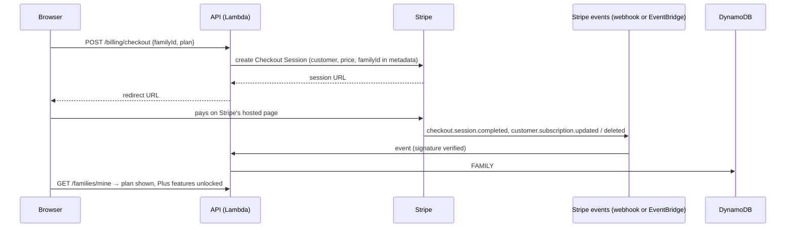

# Plan: monetization

How Family Foodie Book could make money without spoiling what makes it good: a private, ad-free place for families to keep their recipes.

Status: **a strategy and plan, nothing built.** The figures below are illustrative, not forecasts. Pricing pages and laws change, so check current terms before acting. This is not legal or tax advice.

## 1. What to sell (and what not to)

The core value is **keeping a family's recipes safe and shared**. Charging for the basics (writing recipes, joining a family) would stop the network growing, because families only work if everyone joins. So keep the basics free and charge **families** for extras that cost us money or that people would happily pay for.

| Option | Fit | Revenue potential | Effort | Recommendation |
|---|---|---|---|---|
| **Family Plus subscription** (per family, paid by one member, benefits everyone) | Excellent | Steady and recurring | Medium | **Do first** |
| **Printed family cookbook** (a hardcover of the family's recipes, made on demand) | Excellent: a natural gift (holidays, weddings, memorials) | High per order, seasonal | Medium–high | **Do second** |
| **Affiliate links** on the weekly world-meal plan (groceries, kitchen tools), clearly disclosed | Good, if kept light | Small–medium | Low | Optional, with the weekly plan |
| **Tips / "support the site"** | OK | Small | Very low | Optional, early |
| **Display ads** | Poor | Tiny at small scale | Low to add, high hidden cost | **Avoid**, at least early |

**Why not ads:**
- Ad networks need third-party scripts. That means loosening the strict Content Security Policy (more XSS risk) and showing cookie-consent banners.
- They track your users, and they slow the site down.
- They pay very little until traffic is large.
- A private family space with ads feels wrong.

### Family Plus: what's in it (proposal)

| | Free | Family Plus |
|---|---|---|
| Recipes, comments, families (up to 10), invite links, publishing, themes | ✓ | ✓ |
| Photos on recipes ([plan](recipe-photos.md)) | 1 per recipe | 5 per recipe, larger storage |
| Weekly world-meal plan ([plan](world-meal-of-the-week.md)) | This week's plan on the site | Plus the archive, the email digest and a printable shopping list |
| Printable **PDF cookbook** of the family's recipes | — | ✓ (unlimited downloads) |
| Family theme (cover photo, accent color for the family's pages) | — | ✓ |
| Discount on printed cookbooks | — | ✓ |

**Price idea:** about **$3–4 per month or $30–36 per year per family**, with a 14-day free trial and the yearly plan nudged as the default. Never take away anything people have today; new extras are what's paid.

**Illustrative maths:** 1,000 active families × 4% upgrading × $36/year ≈ **$1,440 a year**, before payment fees and AWS costs. Printed books add, for example, 50 books × $15 margin ≈ **$750**, mostly in November and December. Treat these as a way to reason, not as predictions.

## 2. How payments would work

Use **Stripe** (or a similar processor such as Paddle or Lemon Squeezy, which also handle sales tax for you as "merchant of record"). The site **never sees card numbers**: Stripe's hosted pages collect them, which keeps the site in the lightest category of card-security (PCI) obligations.

- **Checkout**: `POST /billing/checkout` (the family's owner, or any member willing to pay) creates a Stripe **Checkout Session** and redirects to it.
- **Manage or cancel**: `POST /billing/portal` opens Stripe's **Customer Portal**, which handles updating the card, switching plans, cancelling and downloading invoices, so we don't build those screens.
- **Events back from Stripe**:
  - **Option A**: a public webhook route (`POST /billing/stripe-webhook`, no sign-in, **signature checked with the signing secret**, not rate-limited per IP).
  - **Option B**: Stripe can deliver events straight to **Amazon EventBridge** (see Stripe's "event destinations" documentation). That means no public endpoint at all, and a rule routes events to a Lambda.
  - **Recommendation: B.** It's simpler to secure and retries automatically.
- **Entitlements**: store `plan`, `status` and `currentPeriodEnd` on the family item. Every Plus feature checks them **in the API**, not just in the browser. When a subscription ends, keep the data (photos stay) but pause the Plus-only extras, and never delete anything.
- **Secrets**: Stripe's secret key and webhook signing secret go in **AWS Secrets Manager**. Only the billing Lambda can read them.
- **Fees**: Stripe's standard card fee is around 2.9% + 30¢ per US payment, with a small extra percentage for subscription billing. Check Stripe's current pricing.
- **Sales tax and VAT**: subscriptions can be taxable in some US states and many countries. Use Stripe Tax or a merchant-of-record provider rather than working it out by hand.

## 3. Printed cookbooks (second phase)

1. A member picks recipes, an order, a title, a cover photo and a dedication.
2. A Lambda builds a **print-ready PDF**, stored in the private media bucket.
3. Checkout (one-off payment) through Stripe.
4. The order goes to a **print-on-demand partner** with an API (for example Lulu's print API). They print and ship it.
5. Order status is shown on the site, and the receipt is emailed (through SES).

Notes: only include recipes the member can see. Photos must be high-resolution enough for print; warn when one isn't. Check the printer's terms and shipping countries.

## 4. AWS and other services this needs

| Service | Used for | Free plan? | Notes |
|---|---|---|---|
| **Amazon SES** | Receipts, trial reminders, digests, account emails | ✓ | Set up first; see [email-with-ses.md](email-with-ses.md) |
| **AWS Secrets Manager** | Stripe keys, recipe-API key | ✓ | About $0.40 per secret per month |
| **Amazon EventBridge** | Receiving Stripe events; scheduled jobs (digest, trial-ending reminders) | ✓ | |
| **AWS Lambda** | Billing, PDF building, event handling | ✓ | |
| **Amazon S3** | Photos, generated PDFs | ✓ | A private media bucket, RETAIN |
| **Amazon SQS** | Queue for email sends and print orders (retries, throttling) | ✓ | Dead-letter queues so failures are visible |
| **AWS WAF** | Bot and abuse protection once money is involved | ✓ | WAF can't attach to an HTTP API directly. Put the API behind CloudFront (an `/api/*` path on the same distribution) and attach WAF there. That's allowed in us-east-1 for CloudFront. A bonus: the API becomes same-origin, so CORS goes away. |
| **CloudWatch alarms + SNS** | Alerts on errors, failed payments, email bounce rates | ✓ | |
| **AWS Budgets** | A cost alert well below what you're willing to spend | ✓ | Also set the spend limit in AWS Settings |
| **Stripe** (outside AWS) | Payments, subscriptions, invoices, tax | n/a | Or a merchant-of-record provider |
| **Print-on-demand API** (outside AWS) | Printing and shipping cookbooks | n/a | |

### The AWS plan itself

The project is on the **AWS Free plan**, with credits and an end date (currently **$119.71** and **2027-04-20**). Before the site depends on revenue, **upgrade to the Paid plan** in AWS Settings, so the project can't pause when the credits or the plan run out. Then set a **spend limit** and an **AWS Budgets** alert. Paid-plan features such as Amazon Translate (for translating the world-meal plans) become available too.

## 5. Business and legal basics (before taking money)

- A **Terms of Service** and a **Privacy Policy** on the site, linked in the footer. **Done (2026-10-26):** `frontend/terms.html` and `frontend/privacy.html`, with agreement checkboxes on sign-up. Before taking money, update them:
  - add Stripe as a processor, and photos if they're built;
  - add billing, renewal and refund terms;
  - consider a governing-law clause;
  - have a lawyer review them.
- **Account deletion**: a "delete my account" option that removes the profile, recipes, photos and memberships, and deletes the Cognito user. This is needed for privacy laws and app stores.
- **Affiliate disclosure** next to any affiliate link (US FTC rules).
- **Business setup**: a business entity and bank account; tax registration where required. Talk to an accountant.
- **Support**: a monitored `support@familyfoodiebook.com` (the reply-to on all emails).

## 6. Roadmap

| Phase | What | Needs |
|---|---|---|
| 0. Foundations | SES set up and out of the sandbox; ~~Terms and Privacy pages~~ (done); account deletion; Budgets and alarms; upgrade to the Paid plan | [email-with-ses.md](email-with-ses.md) |
| 1. Make it worth paying for | Recipe photos; the weekly world-meal plan | [recipe-photos.md](recipe-photos.md), [world-meal-of-the-week.md](world-meal-of-the-week.md) |
| 2. Family Plus | Stripe Checkout and Portal, EventBridge events, entitlements, PDF cookbook, trial emails | Secrets Manager, EventBridge, SES |
| 3. Printed cookbooks | The PDF builder at print quality, the print partner, order tracking | S3, SQS, Stripe one-off payments |
| 4. Harden | WAF via CloudFront, abuse monitoring, payment-failure handling ("your card failed" emails, grace period) | WAF, CloudWatch |

**What to measure** (CloudWatch metrics, or simple counters in DynamoDB): weekly active families, the share of families with 3 or more members, recipes added per week, trial starts and conversions, cancellations and their stated reasons. Grow features toward whatever families actually use.
