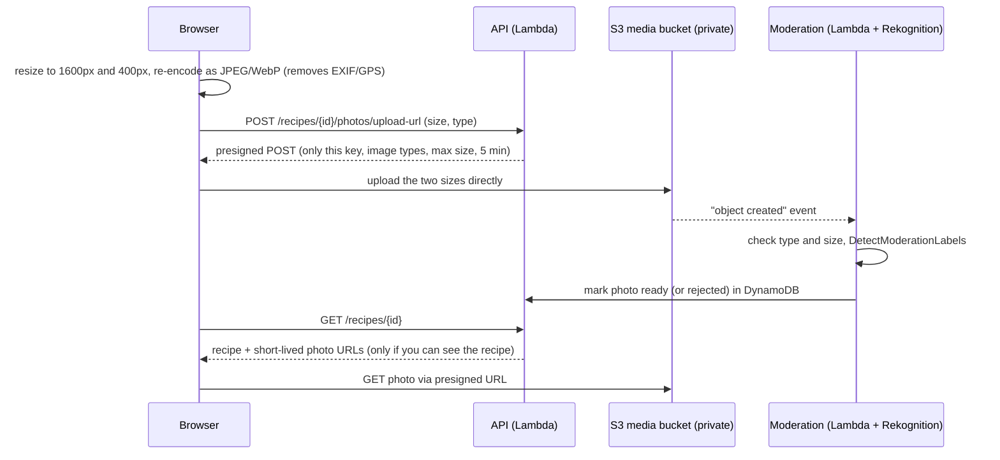

# Plan: photos on recipes

**Goal:** authors can add up to a few photos to a recipe. Cards show a thumbnail, the recipe page shows the photos, and **family-only recipes keep their photos family-only**.

Status: **planned, not built.** All services used are available on the project's Free plan (S3, Lambda, CloudFront, Rekognition).

## 1. What users get

- On the recipe form: **Add photos**, up to **5 per recipe**, with drag-to-reorder. The first photo is the cover.
- On Home and family pages: the cover photo appears as the card's thumbnail.
- On the recipe page: the cover is large at the top, the rest show as a strip, and tapping one shows it full-size.
- The author can remove or reorder photos when editing.
- Publishing a family recipe takes its photos with it. Making it family-only again hides them again.

## 2. Architecture

### Key decisions

| Decision | Choice | Why |
|---|---|---|
| Where photos live | A **new private S3 bucket**, separate from the site bucket | The site bucket is overwritten on every deploy (BucketDeployment), and user data must never be deleted by a deploy. It also keeps different permissions and lifecycle rules apart. Set **RETAIN** like the table. |
| How uploads reach S3 | **Presigned POST from the browser straight to S3** | Image bytes never pass through Lambda or API Gateway, which have payload limits, cost per millisecond, and the 10 s timeout. The presigned policy locks the **exact object key**, the **content type** (`image/jpeg` or `image/webp`) and the **size range** (for example, up to 5 MB), and expires in minutes. |
| Resizing | **In the browser** (canvas → JPEG/WebP at 1600 px and 400 px) | No image library in Lambda (Pillow would need ARM wheels and adds cold-start time). Uploads are smaller and faster. Re-encoding **removes EXIF metadata, including the GPS location** phones embed, which is a real privacy issue for home kitchens. |
| Checking what was uploaded | A **Lambda triggered by S3 "object created"** that checks the file's real type and size and runs **Amazon Rekognition `DetectModerationLabels`** | The browser can't be trusted. Rekognition flags explicit or violent images before anyone else sees them. Until checked, a photo is `pending` and shown only to its author. |
| How photos are served | **Short-lived presigned GET URLs** returned with the recipe (about 1 hour) | A family photo must follow the same rule as its recipe: the API only issues URLs to people who can see the recipe. It also keeps working when a recipe is published or made private again, with nothing to move. |
| Later, at higher traffic | Serve **public** recipes' photos through **CloudFront** (a `/media/*` behavior with OAC on the media bucket), keeping presigned URLs for family photos | CDN caching makes public photos faster and cheaper. Publishing would then copy a photo into a public prefix, and making it private would delete the copy. |
| Orphans | An **S3 lifecycle rule** deletes `pending/` uploads after 1 day; deleting a recipe deletes its photos | No paying to store abandoned uploads. |

## 3. Data model

Add to the recipe item (`RECIPE#<id>/META`):

| Attribute | Example | Notes |
|---|---|---|
| `photos` | a list of `{photoId, status, width, height, createdAt}` | At most 5, in display order. `status` is `pending`, `ready` or `rejected`. |

S3 object keys: `recipes/<recipeId>/<photoId>/full.webp` and `…/thumb.webp`. IDs are random, but **access never depends on keeping a key secret**: the bucket is private, and only presigned URLs work.

## 4. API changes

| Route | Who | Does |
|---|---|---|
| `POST /recipes/{id}/photos/upload-url` | The recipe's author | Checks the photo count and a new **`upload` rate-limit bucket** (for example, 20 per hour). Creates a `pending` entry and returns a presigned POST for both sizes. |
| `PUT /recipes/{id}/photos` | Author | Reorders or removes photos (the body is the new list of `photoId`s) |
| `GET /recipes/{id}` (existing) | Anyone who can see the recipe | Adds `photos: [{photoId, thumbUrl, fullUrl, width, height}]` with presigned GET URLs, `ready` photos only (the author also sees `pending`) |
| Feed routes (existing) | Same as today | Add a `coverThumbUrl` for each card |

Infrastructure changes in `infra/recipe_stack.py`:
- the media bucket;
- a CORS rule on the bucket, allowing POST and GET from `https://familyfoodiebook.com` only;
- the moderation Lambda and its S3 event;
- permissions: the API Lambda may `PutObject` (for presigning), `GetObject` and `DeleteObject` on the media bucket; the moderation Lambda may read objects and call `rekognition:DetectModerationLabels`;
- the CSP: add the media bucket's host to `img-src` and `connect-src`;
- the route list (`ROUTES`), which the existing test checks.

Pydantic limits: an **allow list** of content types, `image/jpeg` and `image/webp` only, and a size of at most 5 MB. Anything else is refused, including SVG, which can contain scripts.

## 5. Frontend changes

- Recipe form: a file picker (`accept="image/*"`, `multiple`), preview thumbnails, an upload progress bar, reorder and remove.
- `recipeCard()`: an optional thumbnail with `loading="lazy"`, fixed dimensions so the layout doesn't jump, and `alt` text. Alt text defaults to the recipe title, with an optional caption field.
- Recipe page: a cover image plus a strip of thumbnails, and a simple full-size viewer that reuses `<dialog>`.

## 6. Tests to add

- The upload URL is only issued to the author, and respects the 5-photo limit and the upload rate limit.
- The presigned policy contains the exact key, type and size limits.
- Photo URLs are only returned to people who can see the recipe, including after publish and un-publish.
- The moderation handler marks `ready` or `rejected`, and rejects files whose real type doesn't match.
- Deleting a recipe deletes its photos.
- The infrastructure tests: the media bucket is private, retained, has its lifecycle rule and only allows CORS from the site.

## 7. Cost (approximate)

| Item | Rough cost |
|---|---|
| S3 storage | about $0.023 per GB-month: thousands of photos at around 300 KB each costs cents |
| S3 requests | fractions of a cent per thousand |
| Rekognition moderation | about $0.001 per image at low volume |
| Lambda | within the free allowance |

## 8. Build order

1. The media bucket, presigned upload and GET URLs, the data model and the form UI, without moderation (photos are author-visible only until marked ready by hand).
2. The moderation Lambda with Rekognition, and showing `ready` photos to everyone allowed.
3. Thumbnails on cards, the full-size viewer, reordering.
4. Later: CloudFront for public photos, once traffic justifies it.
