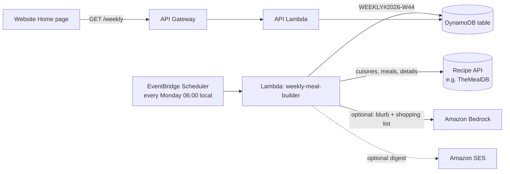

# Plan: "Around the World" weekly meal plan

**Goal:** every week the site picks a **random country** and builds a **week of meals** from that country's cooking. It shows on Home as "This week: Moroccan", with a shopping list. People can save any meal into their own recipes or share it with a family. Optionally, subscribers get it by email (see [email-with-ses.md](email-with-ses.md)).

Status: **planned, not built.** All the AWS services involved are on the Free plan (Lambda, EventBridge Scheduler, DynamoDB, and optionally Bedrock).

## 1. "Parsing the internet": where the recipes should come from

The literal approach, crawling random recipe websites and extracting their recipes, is the one to **avoid**:

| Problem | Why it matters |
|---|---|
| Website terms of use | Many recipe sites forbid automated scraping. Ignoring that risks blocks, takedown requests or legal trouble, especially once the site makes money. |
| Copyright | A plain list of ingredients generally isn't protected, but recipe **descriptions, instructions written in the author's own words, and photos are**. Copying them is the risky part. (This is general information, not legal advice.) |
| Fragile and inconsistent | Every site is laid out differently and changes without warning. Quality varies, and ads and pop-ups get in the way. |
| Safety and quality | No review: wrong quantities, unsafe cooking temperatures, or no allergy information. |

**Recommended sources, best first:**

1. **A recipe API with a cuisine filter and a license that allows this use.**
   - **TheMealDB** is the natural fit. It lists cuisines ("areas"): `list.php?a=list`. It lists the meals for an area: `filter.php?a=<Area>`. And it returns full recipes by ID: `lookup.php?i=<id>`.
   - Its free test key `1` is for **development and education only**. A public release needs a **supporter key**; per its site this is a paid upgrade through PayPal, and it also unlocks the full database instead of 100 items.
   - Read its Terms of Use before launching, especially for commercial use.
   - Alternatives: Spoonacular or Edamam (bigger, with commercial plans, cuisine filters and nutrition data).
2. **Structured data from sites that permit it.** Many recipe pages publish machine-readable `schema.org/Recipe` data. Use this only for sites whose terms allow it, store just the **facts** (name, ingredient list, times), always **link to the original** with credit, and don't copy their text or photos.
3. **AI-written meals (Amazon Bedrock)**, as a supplement rather than the main source. A model can write a week of dishes typical of a country, with original wording.
   - **Pros**: no licensing issue for the text, and it covers countries the API has few recipes for.
   - **Cons**: it can be confidently wrong about quantities, food safety or authenticity. If used, label the meals as **AI-generated**, have a person review them before they're shown, and never present AI output as a family's traditional recipe.

**Recommendation:** TheMealDB (with a supporter key) as the main source, with Bedrock only for **extras** around those real recipes: a short "about this cuisine" paragraph, and a combined **shopping list** that merges the week's ingredients. Both labeled as AI help.

## 2. Architecture

1. **EventBridge Scheduler** runs the builder once a week. It supports a time zone, so 06:00 Monday stays 06:00 local time across daylight-saving changes.
2. **The weekly-meal-builder Lambda**:
   1. gets the list of cuisines and drops ones used in the **last 12 weeks** (kept in DynamoDB) and placeholder values like "Unknown";
   2. picks one at random;
   3. lists that cuisine's meals and picks **7 different ones**, preferring main dishes. If a cuisine has fewer than 7, it repeats a favorite or adds a side or dessert, and says so;
   4. looks up each meal and **converts it to our recipe shape**: title, ingredients (amount + item), steps, plus `source` (name and link) and `cuisine`;
   5. optionally asks Bedrock for the cuisine blurb and the merged shopping list;
   6. writes one item: `pk = WEEKLY#<ISO year-week>`, `sk = META`, with the cuisine, country name, days 1–7, the shopping list, sources and a `generatedAt` time.
3. **The API** gets new routes (and matching `ROUTES` entries):
   - `GET /weekly` (public): this week's plan;
   - `GET /weekly/{week}` (public): earlier weeks, for an archive;
   - `POST /weekly/{week}/days/{n}/save` (signed in): copies that meal into **your** recipes as public or family-only (choose which), keeping the source credit. It's a copy, so you can edit it.
4. **The website** gets a "This week around the world" card on Home (the country, a flag emoji, 7 day tiles), a week page with the shopping list (with a "copy list" button reusing the existing copy helper), and a **Save to my recipes** button on each day.

### Cuisine vs. country

Recipe APIs group by **cuisine** ("Moroccan", "Mexican", "Japanese"), not by country. Keep a small mapping table (cuisine → country name and flag), and simply leave out cuisines that don't map cleanly to one country.

### Reliability

- **Retries**: if the recipe API is down, the scheduler retries; set a retry policy and a dead-letter queue (SQS) so failures aren't silent.
- **A fallback**: if a run fails completely, keep showing last week's plan with "next plan coming soon", rather than an empty card.
- **The API key** (supporter key, Spoonacular key, etc.) goes in **AWS Secrets Manager** (about $0.40 per secret per month) or SSM Parameter Store (free for standard parameters), never in code or `config.json`.
- **Caching**: the builder runs once a week, so the outside API is called about 15–20 times a week, far below any rate limit.

## 3. Data model addition

| pk | sk | Item |
|---|---|---|
| `WEEKLY#2026-W44` | `META` | `cuisine`, `country`, `flag`, `days` (7 meals in our recipe shape plus `source`), `shoppingList`, `blurb` (if any), `aiAssisted` (true/false), `generatedAt` |
| `WEEKLY#HISTORY` | `META` | The cuisines used in recent weeks (for "don't repeat") |

## 4. Tests to add

- The builder with a **fake** recipe API: it skips recent cuisines, picks 7 distinct meals, copes with fewer than 7, converts the format correctly, and keeps source credit.
- A failure in the recipe API leaves last week's plan in place.
- `GET /weekly` is public and rate-limited per IP; `save` requires sign-in and creates a normal recipe in your account with the visibility you chose.
- Infrastructure: the scheduler exists with a time zone and a retry policy, the secret is readable only by the builder Lambda, and the routes match.

## 5. Cost (approximate)

| Item | Rough cost |
|---|---|
| EventBridge Scheduler | Effectively free (one run a week) |
| Lambda | Free allowance |
| DynamoDB | Cents |
| Bedrock (optional) | Fractions of a cent to a few cents per weekly run with a small model, depending on the model |
| Recipe API | TheMealDB supporter upgrade (a one-off or recurring fee per its site), or a commercial API plan |
| Secrets Manager | ≈ $0.40/month per secret |

## 6. Build order

1. The builder Lambda with TheMealDB's test key, run by hand. Store the plan and show it on Home.
2. The scheduler, retries and fallback; the archive of past weeks.
3. "Save to my recipes", and the shopping list with copy.
4. Get the supporter key (or a commercial API) **before** launching publicly; move it into Secrets Manager.
5. Optional: Bedrock extras, clearly labeled; the email digest through SES.
